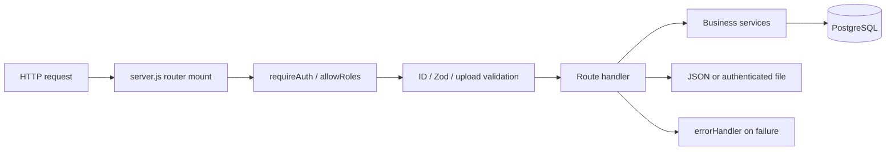

# Backend Code Guide

Source checked: October 27, 2026. This guide explains the current Node/Express API, consolidated services, database contract and business rules. Read the [overview](CODEBASE_OVERVIEW.md) for orientation; use the [frontend guide](FRONTEND_CODE_GUIDE.md) to locate each action's browser page. The current source and these updated guides take precedence over older workflow descriptions.

## Contents

1. [Learning order and request pipeline](#1-learning-order-and-request-pipeline)
2. [Authentication and accounts](#2-authentication-and-accounts)
3. [Database and transaction model](#3-database-and-transaction-model)
4. [Billing and SOA lifecycle](#4-billing-and-soa-lifecycle)
5. [Payments and the accounting ledger](#5-payments-and-the-accounting-ledger)
6. [Forecasts and recommendations](#6-forecasts-and-recommendations)
7. [Route reference](#7-route-reference)
8. [Service reference](#8-service-reference)
9. [Scripts, tests and debugging](#9-scripts-tests-and-debugging)

## 1. Learning order and request pipeline

Read `server.js`, `config/db.js`, authentication/validation/error middleware and `authRoutes.js`. Next trace bill reads, generation, then payment approval. Start forecasting with `buildForecast` in `services/analytics.js` before reading SQL regeneration. Use the [service directory guide](../backend/services/README.md) and the `// #region` index in each feature file to find related functions.

The project uses ES modules (`type: module`) and parameterized SQL through `pg`; there is no ORM or separate controller/model layer. Route files contain substantial workflow orchestration. Reusable calculations and integrations live in services.



| File | Responsibility |
| --- | --- |
| [server.js](../backend/server.js) | Loads environment, configures CORS/JSON and trusted proxy hops, mounts routers, exposes `/` and `/api/health`, handles 404/errors, listens on `PORT` or 5000, and starts registration cleanup, protected-SOA maintenance and the optional reminder scheduler. |
| [config/db.js](../backend/config/db.js) | Loads `backend/.env` by file URL. Uses `DATABASE_URL` when supplied, otherwise `DB_HOST`, `DB_USER`, `DB_PASSWORD`, `DB_NAME`, `DB_PORT`. With a connection URL, `DB_SSL=true` enables TLS. Keeps PostgreSQL DATE values as `YYYY-MM-DD` strings. |
| [authMiddleware.js](../backend/middleware/authMiddleware.js) | `requireAuth` verifies JWT, reloads current user role/active/auth version, and attaches `{ id, role }` to `req.user`. `allowRoles` rejects excluded roles with 403. |
| [validate.js](../backend/middleware/validate.js) | `validateBody(schema)` stores parsed Zod output in `req.validatedBody`; failure returns 400 with field issues. `requireId` validates positive safe integer `:id` into `req.resourceId`. |
| [errorHandler.js](../backend/middleware/errorHandler.js) | Maps input/upload errors to 400, unavailable storage configuration to 503, unique/foreign-key conflicts to 409, explicit application statuses to their response, and unexpected failures to 500. |
| [receiptUpload.js](../backend/middleware/receiptUpload.js) | Enforces receipt extensions, byte limits and genuine JPEG/PNG image data before resident payment preview/submission. Uses the receipt policy section in `services/receipts.js`. |

Multipart routes use Multer rather than `express.json` to populate file/body input. Some handlers validate query strings or multipart fields inline. Follow actual middleware order instead of assuming every endpoint uses every helper.

## 2. Authentication and accounts

[authRoutes.js](../backend/routes/authRoutes.js) owns registration, login, activation and recovery. [userRoutes.js](../backend/routes/userRoutes.js) owns Admin account management.

### Registration, verification and approval

1. `registrationRoutes.js`, mounted inside `/api/auth`, handles `POST /register/send-otp` and `/register/verify-otp`. A six-digit, one-time email code has a ten-minute lifetime, attempt limits and resend quotas.
2. Successful verification issues a registration grant. `POST /register` requires that `registrationToken`, plus email, password and structured `firstName`, optional `middleInitial`, and `lastName`. Legacy `fullName` clients remain accepted when they supply the grant. Client-supplied roles are rejected; public registration always creates a Resident.
3. `accounts.js` normalizes identity, serializes grant consumption and enforces durable registration quotas. `passwords.js` applies the shared password policy and generates a salted scrypt hash; verification still accepts existing bcrypt hashes.
4. One transaction consumes the grant, inserts an email-verified user with `approval_status='PENDING'`, writes the audit and notifies Admin. Email verification does not grant approval.
5. Admin separately approves the account through `userRoutes.js`. The legacy verification-link flow remains for accounts that still need email verification and preserves their current approval state.

Login requires correct credentials, an active account and `APPROVED` status. `requireAuth` rechecks active/approved state and session version on protected requests. Protected SOA requests additionally require the account's current email to be verified. Approval does not create a unit assignment.

### JWT and session invalidation

Login signs `{ id, authVersion }` for eight hours using `JWT_SECRET`. Protected requests compare that version to `users.auth_version` and use the database role. Deleting/deactivating a user or changing the session version invalidates access before token expiry.

`POST /forgot-password` starts a six-digit OTP challenge; the current API returns explicit errors for unknown/ineligible accounts. `POST /verify-password-reset-otp` verifies the email/challenge/code and issues a reset grant. `POST /reset-password` consumes that grant, updates the password and invalidates old sessions. Codes expire after ten minutes, have five allowed attempts and a 60-second resend cooldown. Recovery is code-based, not a reset link in the email.

Authenticated Admin, Collector and Resident accounts can use `POST /change-password` with their current password; success returns a refreshed JWT. Staff profile edits and verified email changes are in [accountRoutes.js](../backend/routes/accountRoutes.js), mounted at `/api/account`. Browser placement differs by role: staff use Settings, while Residents change their password in Profile.

[accounts.js](../backend/services/accounts.js), [email.js](../backend/services/email.js), [passwords.js](../backend/services/passwords.js) and migration [034](../backend/database/migrations/034_enforce_unique_user_email.sql) own identity, challenges, messages and uniqueness. Password rules are 12–128 Unicode characters with uppercase, lowercase, number and symbol requirements. SMTP credentials and `JWT_SECRET` are backend configuration, never browser values.

## 3. Database and transaction model

The authoritative schema is [schema.sql](../backend/database/schema.sql) plus [numbered migrations](../backend/database/migrations/). The base schema alone is not the finished system. `initDatabase.js` executes filenames matching three digits plus underscore in sorted order. The current set reaches `043` and includes two distinct `022_...` files; `units.sql` does not match the initializer pattern. Recent migrations cover OTP recovery, staff email changes, retained history workbooks, expanded names, registration OTPs, payment references, detailed audits and protected SOA requests.

There is no migration-history table. Re-executing all migrations is not a general upgrade strategy: some alter/remove data, and category-ledger activation requires a clean start. Use `db:init` for a fresh/disposable database. For an existing payment installation, follow the [category rollout reference](category-payments-rollout.md).

### Core data graph

`users -> unit_assignments -> units -> unit_bills -> bill_charges` connects identity to billing. `billing_periods` groups readings and bills. Payment submissions connect to units and optionally an intended bill. Approved submissions produce category allocations; applications connect those allocations to a bill's `PRINCIPAL` or `LATE_PENALTY` component.

SOAs snapshot unit/payer, dates, readings, penalty percentage and template to preserve generated document context. Revision/reason metadata records corrections. Read each endpoint to see whether it uses a snapshot or a live field.

PostgreSQL commonly returns numeric values as strings. Services convert/round values where needed. Monetary allocation uses integer centavos to avoid fractional-cent drift. Dates without times stay strings; date-sensitive ledger/assignment operations use Manila dates where specified.

### Why one connection per transaction matters

Illustrative mutation pattern:

```js
const client = await pool.connect()
try {
  await client.query('BEGIN')
  // Lock records, validate current state, and write using this client.
  await writeAuditLog({ client, actorUserId, entityName, entityId, action })
  await client.query('COMMIT')
} catch (error) {
  await client.query('ROLLBACK').catch(() => {})
  throw error
} finally {
  client.release()
}
```

This explains the pattern, not a complete endpoint. `pool.query` may use another connection and escape the transaction. Services accept `client` so writes, audits and notifications can commit together.

Payment mutations lock the unit, then relevant rows, serializing approval, generation credit application, penalties and corrections. Database constraints add protection; migration `033` includes deferred ledger checks against category/component/budget over-application.

### Activity Log contract

All audit helpers live in [audit.js](../backend/services/audit.js). `writeAuditLog` records identified user changes using the caller's transaction; automatic delivery/maintenance changes do not become user activity. Saved actor and target snapshots preserve historical identities, and sanitization excludes credentials, raw OCR, files and private storage data.

`presentAudit` returns compact summaries with safe changes/counts. Publication entries identify a single resident and unit or show the bulk SOA count, up to three saved resident/unit previews and the remaining count. Detail responses retain the complete affected-record snapshots. Existing entries can use saved context without rewriting history. The coverage registry is the last section of `audit.js`; its test filenames remain `auditCoverage.test.js` and `auditDetails.test.js`.

## 4. Billing and SOA lifecycle

[billingPeriodRoutes.js](../backend/routes/billingPeriodRoutes.js) orchestrates periods, imports, generation, forwarding, publication and mail recovery. [billRoutes.js](../backend/routes/billRoutes.js) reads and corrects individual bills.

### Import and generation

1. Collector creates `LIVE_BILLING` in `DRAFT` with coverage/due dates, water rate, association rate per square meter and penalty percentage.
2. Preview reads `.xlsx` using ExcelJS and namespace compatibility. Live headers are `UNIT`, `PREVIOUS`, `PRESENT`.
3. Validation checks unit matching, numeric values, negative consumption and continuity. Preview is not final save.
4. `PUT /:id/readings` writes normalized rows/flags in a transaction. Server calculations take precedence over workbook formulas.
5. `POST /:id/generate` requires a draft live period, association rate and unit areas. It creates one bill per unit and two category charge lines.
6. Valid water quantity is current minus previous. Missing/flagged water is zero with a generation warning. Association quantity is billable square meters. Eligible prior category credit is applied. Batch becomes `GENERATED`, with recommendation/audit updates.

Water charge = consumption times cubic-meter rate. Association principal = billable area times square-meter rate. Current policy adds the configured one-time late penalty to association principal unpaid at due date, never water. Applications reduce the corresponding category/component balance.

Historical analytics imports are a separate flow in `analyticsImportRoutes.js`. The web uploader requires only `UNIT`, `PREVIOUS`, and `CURRENT` (`PRESENT` is accepted); consumption is computed. Extra rate/charge columns are ignored, and an existing saved rate is selected internally. Original workbook bytes are retained for authenticated downloads. See [HISTORY_IMPORT_FORMAT.md](HISTORY_IMPORT_FORMAT.md); history uploads do not create live SOAs.

### Forward, publish and delivery

Collector can reopen a generated, unforwarded batch to `DRAFT`: readings remain, generated bills are removed. Forwarding requires `GENERATED` and no flagged meter readings, changes to `FORWARDED`, refreshes forecasts/recommendations and notifies Admin.

Admin publication sets individual bill visibility and creates notifications, plus delivery records when email is requested. It does not change batch status; a fully published live batch can remain `FORWARDED`. `CLOSED` is supported by reads and used for imported historical periods. Delivery happens in the background after commit, so SMTP failure does not undo publication. Retry/resend uses saved delivery records. Unpublication clears the bill's publication fields and removes publication notifications/delivery rows without changing batch status.

Admin can unpublish one SOA, a selected subset or the full batch. Selected/all batch actions verify the Admin's current password and recheck publication state under locks. A single-resident publication is audited as that resident's SOA, not just a generic batch action. See [SOA_BULK_UNPUBLISH.md](SOA_BULK_UNPUBLISH.md).

### Resident Request SOA

[soa.js](../backend/services/soa.js) owns the authorized snapshot, password, rendering, qpdf encryption and request/cooldown lifecycle; [email.js](../backend/services/email.js) builds and sends the protected attachment. These are separate from publication notices and payment reminders.

1. A Resident's authenticated `GET /api/bills/:id/protected-exports` checks recent preparation/delivery state without sending email.
2. `POST` to the same path uses an empty body and UUID `Idempotency-Key`. The server loads current verified email, assignment and published statement data; it never accepts browser-supplied recipient/PDF/totals.
3. The server renders an AES-256 R6 PDF and emails it as an attachment. The opening password is the resident's lowercase surname without spaces plus four random digits; the exact password and instructions appear in the same email. Names come from stored full names, with common compound surname particles handled by the helper.
4. States are `PREPARING`, `EMAIL_PENDING`, then `READY` after SMTP acceptance, or `FAILED`. Retry identity and concurrent-request deduplication avoid duplicate sends.
5. A successful send starts a server-enforced 30-minute cooldown per resident/SOA/current email. Responses include `nextRequestAt`; new keys during cooldown receive `429 SOA_EMAIL_COOLDOWN` and `Retry-After`. Failed sends retain the separate attempt-rate limits.
6. `GET /api/soa-exports/:exportId` polls status. The old `/file` route returns `410 SOA_EMAIL_ONLY`; residents download the PDF from email. Passwords and new PDF bytes are not saved in PostgreSQL or returned to the browser.

Email layouts use the shared green-header template in `email.js`. SOA dates use full months, such as `January 1, 2026`; monetary values include grouping and two decimals, such as `PHP 2,228.24`. Authenticated TLS and sender authentication support delivery but cannot guarantee Inbox placement. Migration `043`, qpdf/fonts and SMTP must pass deployment preflight. See [PROTECTED_SOA_DOWNLOADS.md](PROTECTED_SOA_DOWNLOADS.md) for operational limits and recovery.

### Corrections and resident reports

`PATCH /api/bills/:id` permits Admin/Collector correction in `GENERATED`, `FORWARDED` or `CLOSED` state. A reason belongs in the correction payload. If pending/approved payment activity exists, billing-detail changes require `billingErrorReportId` matching an open report for that SOA.

Correction locks unit/bill, validates dates/readings/charges, updates snapshots and applicable meter readings, reconciles that SOA's applications when needed, increments revision metadata and audits. For a published bill it updates notifications/delivery attempts, then sends mail after commit. Only Collector resolves the separate report through its resolution endpoint.

Residents can report an accessible published SOA up to three times per Resident/SOA, counting both open and resolved reports. Correction may release applied cash into advance in its original category; it preserves payment budgets, purposes and invoice references.

## 5. Payments and the accounting ledger

Read the payment/credit allocation section of [payments.js](../backend/services/payments.js), then its ledger section and [paymentRoutes.js](../backend/routes/paymentRoutes.js). Allocation is pure; the ledger manages SQL, locks and application changes.

| Concept | Stored in | Meaning |
| --- | --- | --- |
| Submission | `payment_submissions` | Proof/manual record, review status, intended SOA, purpose and verified facts. |
| Category allocation | `payment_charge_allocations` | Approved cash budget for `WATER` or `ASSOCIATION_DUES`, including category invoice reference. |
| Application | `payment_applications` | Cash applied to SOA principal or association penalty, linked to its category allocation. |
| Advance | Allocations minus applications | Approved cash not consumed, retained in its designated category. |

### Purpose and permissions

`WATER` designates all cash to water; `ASSOCIATION_DUES` designates all cash to association; `COMBINED` covers the selected SOA's association balance before water and retains excess in association advance. Within a category, principal is paid before penalty.

An active owner assignment permits all three purposes. A tenant-only assignment permits water only. The permission section in [payments.js](../backend/services/payments.js) checks assignment, purpose and positive payable charge. [billing.js](../backend/services/billing.js) adds `allowedPaymentPurposes`, `payableBalance` and related resident fields.

Full SOA and tenant payable status are different. Paying water can settle the tenant's payable balance while association dues keep the overall SOA `PARTIAL`.

### Worked examples

Assume association PHP 1,608.84 and water PHP 58.90, with no penalties/prior applications:

| Approved purpose/amount | Result |
| --- | --- |
| `WATER`, PHP 58.90 | Water settled; association PHP 1,608.84 remains; full SOA partially paid. |
| `WATER`, PHP 100.00 | Water settled; PHP 41.10 remains water advance. |
| `COMBINED`, PHP 1,650.00 | Association settled; PHP 41.16 pays water; water PHP 17.74 remains. |
| `COMBINED`, PHP 1,800.00 | Both settled; PHP 132.26 remains association advance. |

`cents` validates at most two decimals and converts to integer centavos; `money` converts back. Preview does not reserve balances: approval/manual save rechecks current state under locks.

### Approval flow

1. Receipt preview analyzes image/text and returns quality/OCR candidates. Final submission revalidates access/purpose and stores pending proof using private Cloudinary assets.
2. Admin supplies verified amount/date/method/reference, or rejects with remarks.
3. The transaction locks unit/submission, rejects an already-reviewed record and checks duplicate approved references.
4. Approval stores verified facts and calls `createPaymentAllocations` to create category budgets and apply approved cash to the selected SOA.
5. That SOA's applications may be rebuilt for an earlier verified date, with penalty recalculation. Approval does not sweep other SOAs or unrelated existing credit.
6. Audit, submitter notification and recommendations commit together. Failure rolls back the database operation.

Manual Admin entry follows the same allocation rules and can create category advance without a target bill. Future generation consumes eligible prior advances for the same unit/category in ledger order.

Late approval of a proof dated before/on due date can reduce association penalty. The ledger recalculates unpaid association principal at due date, preserves budgets/invoices and audits the penalty change. This is not a penalty on the whole SOA or recurring monthly compounding.

### Invoices and receipts

Invoices belong to approved payment/category allocations, not one bill-level invoice. Partial payments retain separate invoices; combined payment may share a number across two categories. Admin/Collector can patch category invoices. The bill payment-reference endpoint retains a general note and rejects the old ambiguous invoice write.

Keep three reference concepts separate: `officialReceiptNo` is the system-generated `REF-...` transaction reference; `verifiedReferenceNo` is the reviewed cash/bank/e-wallet proof reference; category `invoiceNumber` belongs to payment allocations. Names retained in schemas do not make them interchangeable. See [PAYMENT_OFFICIAL_RECEIPTS.md](PAYMENT_OFFICIAL_RECEIPTS.md).

Private images are served through authenticated `/api/payments/:id/receipt` with role visibility checks. Cloudinary stores authenticated assets and the backend streams them; legacy local receipt support remains for older records. Current deletion allows rejected submissions only.

## 6. Forecasts and recommendations

[analytics.js](../backend/services/analytics.js) contains predictive models, prescriptive recommendations, usage review, benchmarks and staff guidance in separate comment sections. [analyticsRoutes.js](../backend/routes/analyticsRoutes.js) assembles visible history/diagnostics.

### Current model

1. Filter history to source month. Missing source-month reading is insufficient; flagged newest reading returns `FLAGGED_READING`.
2. `selectConsecutiveReadings` walks backward until a gap, invalid row or 12-month maximum. Five valid consecutive rows are required.
3. `ACTIVE_FORECAST_POLICY` is `regression_first`: full-window Linear Regression is primary.
4. Check each of the latest three readings against its five preceding valid months. Without that baseline, it cannot trigger a switch. A spike must exceed the prior median by more than `max(3 m3, 75% of median, 3 times median absolute deviation)`. An unexpected zero requires prior median at least 1 m3 and three immediately preceding positive months. Ordinary drops and recurring zeros do not trigger a switch.
5. While a qualifying event remains in that three-month window, `STABLE_RECENT_ENSEMBLE` averages last-month consumption, recent three-month average and recent five-month median. Return to regression after it expires; preserve all actual readings.
6. Round consumption to three decimals and estimated charge to two; return `READY`, sample count, model name, selection explanation in `reason`, and applicable model parameters. Unavailable forecasts retain their eligibility reason and display as "No forecast".

The `stable`, `legacy`, and `revised` policies remain available for comparisons; their presence does not make them the active default. Forecast estimates do not create real charges.

Five consumptions `2, 4, 6, 8, 10` produce regression prediction 12. Fewer than five consecutive valid months produce no ready forecast. Valid zero is data, not missing input.

The eligibility section in [analytics.js](../backend/services/analytics.js) permits forwarded/closed live periods or explicitly visible historical periods for shared analytics. Its transactional refresh section rebuilds eligible source periods chronologically and recommendations in one transaction. Forwarding/import/refresh matter when saved forecasts appear stale.

### Accuracy and prescription

MAE is mean absolute error; RMSE weights large misses more heavily. WAPE is total absolute error divided by total actual consumption, shown as a percent. Display accuracy is `max(0, 1 - WAPE ratio) * 100`, not confidence probability. No valid pairs produce null metrics; zero total actual consumption produces null WAPE/accuracy. The evaluation section of `analytics.js` uses matching valid unit/month pairs, baseline comparisons and exclusion counts.

Recommendations include flagged reading review, insufficient history, three-month rising use, vacant use, upcoming balances, high use and monitoring. High-usage comparison uses a 15% threshold and at least two positive recent readings; zeros remain on charts. Residents see permitted types on assigned units and may mark them viewed. Staff can delete recommendations; those actions are audited. Priorities include `HIGH` and `LOW`; migration `030` renames former `MEDIUM` to `LOW`.

Resident insights can be exposed for a generated batch before SOA publication. This is separate from bill visibility and scheduled mail reminders.

## 7. Route reference

Paths include the base mounted in `server.js`. Read each module for payload/query schemas and state guards; role access alone does not permit every action in every state.

| Module | Endpoints and access |
| --- | --- |
| [authRoutes.js](../backend/routes/authRoutes.js), `/api/auth` | Public register/login, OTP password recovery (`forgot-password`, `verify-password-reset-otp`, `reset-password`), legacy email verification/resend; authenticated `GET /me` and all-role `POST /change-password`. |
| [registrationRoutes.js](../backend/routes/registrationRoutes.js), `/api/auth` | Public `POST /register/send-otp` and `/register/verify-otp`; verifies email and issues the grant required by account creation. |
| [accountRoutes.js](../backend/routes/accountRoutes.js), `/api/account` | Staff `PATCH /profile`, `POST /email-change`, and `/email-change/verify`; verifies current credentials/code and updates session/account state where required. |
| [userRoutes.js](../backend/routes/userRoutes.js), `/api/users` | Admin list/detail/create/update/delete, with current-user/deletion/approval/session guards. |
| [unitRoutes.js](../backend/routes/unitRoutes.js), `/api/units` | Role-filtered list/detail for all roles; Admin create/update/delete with reference/password safeguards. |
| [unitAssignmentRoutes.js](../backend/routes/unitAssignmentRoutes.js), `/api/unit-assignments` | Role-filtered list/detail; Admin create/update/end (`DELETE :id`). |
| [billingPeriodRoutes.js](../backend/routes/billingPeriodRoutes.js), `/api/billing-periods` | Staff list/readings preview/read/save; Collector create/update/generate/reopen/forward/delete; Admin `:id/publish`, `:id/unpublish`, `:id/unpublish-selected`, `:id/bills/:billId/unpublish`, email retry/resend. Reading save is `PUT`; actions are `POST`. |
| [billRoutes.js](../backend/routes/billRoutes.js), `/api/bills` | Role-filtered `GET /` and `GET /:id`; staff `PATCH /:id` correction and `PATCH /:id/payment-references` note. |
| [soaExportRoutes.js](../backend/routes/soaExportRoutes.js), `/api` | Resident `GET/POST /bills/:id/protected-exports`, `GET /soa-exports/:exportId`; `/file` is retained as an authenticated email-only error response. The browser cannot download a protected SOA from this route. |
| [paymentRoutes.js](../backend/routes/paymentRoutes.js), `/api/payments` | Resident `POST /bills/:id/preview` and `/bills/:id`; Admin `POST /allocation-preview`, `/manual`, `/:id/review`, rejected-only `DELETE /:id`; Admin/Resident `GET /credits`; role-filtered list/detail/receipt; staff `PATCH /:id/invoice-references`. |
| [analyticsImportRoutes.js](../backend/routes/analyticsImportRoutes.js), `/api/analytics/imports` | Collector list, workbook download (`GET /:periodMonth/workbook`), preview/import and confirmed deletion. Web upload uses unit and previous/current readings; extra charge/rate columns are ignored. These imports never create live SOAs. |
| [analyticsRoutes.js](../backend/routes/analyticsRoutes.js), `/api/analytics` | Resident `GET /resident`; staff `GET /overview`, `GET /units/:id`, `POST /refresh-forecasts`. |
| [prescriptiveRecommendationRoutes.js](../backend/routes/prescriptiveRecommendationRoutes.js), `/api/prescriptive-recommendations` | Resident `GET /resident`, `PATCH /:id/view`; staff `GET /`, `DELETE /:id`. |
| [soaTemplateRoutes.js](../backend/routes/soaTemplateRoutes.js), `/api/soa-template` | Staff `GET /`; Admin `PATCH /`, `POST /assets/:type`; authenticated roles `GET /assets/:type`. |
| [dashboardRoutes.js](../backend/routes/dashboardRoutes.js), `/api/dashboard` | Staff `GET /overview`; Resident dashboard composes its own bill/analytics APIs. |
| [notificationRoutes.js](../backend/routes/notificationRoutes.js), `/api/notifications` | Current-user `GET /`, `PATCH /read-all`, `PATCH /:id/read` with ownership checks. |
| [auditLogRoutes.js](../backend/routes/auditLogRoutes.js), `/api/audit-logs` | Admin filtered/paginated `GET /` and `GET /:id` detail. List responses contain compact identities/changes; the current feed uses the list without expansion. |
| [financialReportRoutes.js](../backend/routes/financialReportRoutes.js), `/api/reports` | Staff `GET /financial`, `/financial/export`; month or inclusive date-range filters and ExcelJS export. |
| [billingErrorRoutes.js](../backend/routes/billingErrorRoutes.js), `/api/billing-errors` | Resident `POST /bills/:id`; staff `GET /` open/resolved/all; Collector `PATCH /:id/resolve`. |

## 8. Service reference

Related helpers are consolidated into one file per feature. Each grouped service includes an index and foldable `// #region` comment sections. See the [service directory guide](../backend/services/README.md) for section contents.

| Service | Responsibilities |
| --- | --- |
| [accounts.js](../backend/services/accounts.js) | Email identities/change challenges, registration verification/quotas, and account safeguards. |
| [passwords.js](../backend/services/passwords.js) | Shared password rules, validation, hashing, reset challenges and reset email delivery. |
| [email.js](../backend/services/email.js) | Email styling, registration/verification messages, SOA notifications and attachments, delivery outcomes and reminder scheduling. |
| [soa.js](../backend/services/soa.js) | Statement templates/assets, passwords, PDF rendering/encryption, authorized snapshots, email requests and cooldowns. |
| [billing.js](../backend/services/billing.js) | Period/date policy, meter validation, billing error support, statement queries and resident bill details. |
| [payments.js](../backend/services/payments.js) | Centavo validation, purposes, permissions, resident/recipient identity, payment allocations, credit, penalties and reconciliation. |
| [receipts.js](../backend/services/receipts.js) | Receipt file policy, OCR/text parsing, quality checks and authenticated private storage. |
| [analytics.js](../backend/services/analytics.js) | History eligibility, anomaly rules, forecast models, recommendations, evaluation/comparison, guidance and refresh. |
| [spreadsheets.js](../backend/services/spreadsheets.js) | Spreadsheet XML compatibility and analytics workbook exports. |
| [financialReports.js](../backend/services/financialReports.js) | Ledger-derived reports, receivables, collections, occupancy and efficiency. |
| [notifications.js](../backend/services/notifications.js) | Inserts transaction-aware alerts with dedupe keys; read/update routes remain in the route layer. |
| [audit.js](../backend/services/audit.js) | Sanitized snapshots, context, summaries, historical identity recovery, transactional writer, delivery outcomes and route coverage. |

Reminders require `SOA_REMINDER_SCHEDULER_ENABLED=true`; timezone uses `SOA_REMINDER_TIMEZONE`. Its three-day email window differs from prescriptive payment-reminder rules. Deduplication means an already-sent overdue event is not emailed daily.

Some `ensure...Schema` helpers create/upgrade supporting tables lazily; they do not replace initialization. `ensurePaymentLedgerSchema` requires active policy version 2 and does not silently migrate legacy payments.

## 9. Scripts, tests and debugging

### Normal local commands

From `backend/`, after configuration and database setup:

```powershell
npm install
npm run dev
npm start
npm test
```

Choose `dev` for nodemon restart or `start` for normal execution; do not run both on one port. `/api/health` checks API/database connectivity, not every migration/integration. See [LOCAL_SETUP_GUIDE.md](../LOCAL_SETUP_GUIDE.md) for installation.

### Script map and effects

| Script / npm command | Purpose and effects |
| --- | --- |
| [initDatabase.js](../backend/scripts/initDatabase.js), `db:init` | Base schema and all numbered migrations; fresh/disposable setup, not a study command for a populated database. |
| [seedUsers.js](../backend/scripts/seedUsers.js), `seed` | Configured Admin/Collector creation with hashed passwords and duplicate-safe identity checks. |
| [importHistoricalAnalytics.js](../backend/scripts/importHistoricalAnalytics.js), `data:import-history` | Writes historical workbook/analytics records; inspect arguments/config first. |
| [migrateLocalReceiptsToCloudinary.js](../backend/scripts/migrateLocalReceiptsToCloudinary.js), `receipts:migrate-cloudinary` | `--dry-run` previews; normal mode uploads and updates metadata, preserving local files. |
| [paymentPreflight.js](../backend/scripts/paymentPreflight.js), `payments:preflight` | Read-only policy/submission/application/advance/legacy-invoice snapshot. Output can include financial record IDs. |
| [paymentMigration.js](../backend/scripts/paymentMigration.js), `payments:migrate` | Requires `--check` for rolled-back validation or `--activate` for persistent migration `033`; direct connection and legacy-activity blockers. |
| [paymentRegression.js](../backend/scripts/paymentRegression.js), `payments:regression` | Opt-in current-database fixtures/DDL rolled back; real unit locks and sequence IDs may advance. Use a maintenance window. |
| [benchmarkForecasts.js](../backend/scripts/benchmarkForecasts.js), `forecasts:capture` / `forecasts:benchmark` | Captures connected-history comparison inputs; `--compare` evaluates them. Inspect flags/output paths before running. |
| [benchmarkWorkbookHistory.js](../backend/scripts/benchmarkWorkbookHistory.js), `forecasts:benchmark-workbooks` | Forecast-policy comparisons using workbook history. |
| [verifyForecastAnalytics.js](../backend/scripts/verifyForecastAnalytics.js), `forecasts:verify-reads` | Connected analytics read consistency checks. |
| [investigateForecastAccuracy.js](../backend/scripts/investigateForecastAccuracy.js) | Diagnostic investigation; inspect arguments before direct invocation. |
| [readForecastWorkbooks.py](../backend/scripts/readForecastWorkbooks.py) | Workbook-reader helper for diagnostics, not a separate prediction server. |
| [runSoaReminders.js](../backend/scripts/runSoaReminders.js), `soa-reminders:run` | One reminder run; may update penalties/delivery rows and send real mail. |
| [migrateRegistrationVerification.js](../backend/scripts/migrateRegistrationVerification.js), `accounts:migrate-registration` | Targeted registration-verification schema migration for an existing environment. |
| [migrateAuditLogs.js](../backend/scripts/migrateAuditLogs.js), `audit:migrate` | Detailed audit migration; preserves the service's snapshot-based history design. |
| [migrateProtectedSoaExports.js](../backend/scripts/migrateProtectedSoaExports.js), `soa-exports:migrate` | Installs migration `043` for protected request metadata/quotas. |
| [protectedSoaPreflight.js](../backend/scripts/protectedSoaPreflight.js), `soa-exports:preflight` | Checks schema, renderer/assets, encryption and SMTP negotiation without sending a resident email. |

Existing-database ledger maintenance follows [category-payments-rollout.md](category-payments-rollout.md). `npm test` does not activate policy, run reminder mail or invoke the current-database payment regression command.

### Tests as executable examples

`npm test` runs `node --test test/*.test.js`; it does not include the nested HTTP suites. Test filenames retain their focused subject names even though production helpers now share feature files:

| Tests under [backend/test](../backend/test/) | Current production file | Coverage |
| --- | --- | --- |
| `paymentAllocation`, `paymentLedger`, `paymentPermissions` | `payments.js` | Exact cents, category credit, penalties and assignments. |
| `billingPeriodPolicy`, `meterReadingValidation` | `billing.js` | Calendar rules, date bounds, continuity and flags. |
| `predictiveAnalytics`, `regressionFirstForecast`, `forecastEvaluation`, `forecastPolicyComparison`, `refreshAnalyticsForecasts`, `usageChangeReview`, `prescriptiveAnalytics`, `adminWaterGuidance` | `analytics.js` | Models, eligibility, comparisons, diagnostics, recommendations and guidance. |
| `emailIdentity`, `emailChange`, `registrationVerification`, `registrationName` | `accounts.js` and registration routes | Identity, challenges, grant consumption and names. |
| `passwordHash`, `passwordPolicy`, `passwordReset` | `passwords.js` | Full-length hashing, validation/parity and OTP reset messages. |
| `emailVerification`, `emailTemplate`, `soaEmail`, `soaReminderScheduler`, `protectedSoaEmail` | `email.js` | Escaping, templates, dates/currency, codes, reminders and attachment transport. |
| `cloudinaryReceipts`, `receiptText`, `receiptUpload` | `receipts.js` and upload middleware | Private storage, OCR parsing and genuine-image validation. |
| `protectedSoaEncryption` | `soa.js` | Real qpdf password/encryption checks when `QPDF_PATH` is set. |
| `auditDetails`, `auditCoverage` | `audit.js` | Safe snapshots, identities, summaries and endpoint coverage. |
| `financialReports`, `combinedReportExport` | `financialReports.js` and report routes | Collections, combined billing and numeric workbook exports. |

Names omit `.test.js`. [helpers/paymentHttpRegression.js](../backend/test/helpers/paymentHttpRegression.js) supports the opt-in database/HTTP regression script, not the top-level test glob. Many unit tests inject fake database/integration behavior; passing unit tests do not establish a deployed database or SMTP/Cloudinary connection.

Targeted npm commands include `test:audit`, `test:soa-exports`, `test:registration`, `test:password-reset`, `test:account-settings`, `test:account-safeguards`, `test:payment-receipts`, `test:soa-dates`, `test:soa-unpublish`, and `test:combined-report`. Check [package.json](../backend/package.json) for the exact files. Relevant HTTP suites use disposable schemas and intercepted mail; read each fixture setup before running against configured infrastructure.

### Debug an API action

1. Record URL, method, payload and response in browser Network tools.
2. Find its mount in `server.js`, then the matching router handler.
3. Check `req.user`, `req.resourceId`, `req.validatedBody`, upload fields and visibility conditions.
4. Read state guards before calculations; trace services and SQL parameters.
5. Identify which writes roll back and which external calls happen after commit.
6. Read the relevant test; reproduce with a disposable database if state is needed.

| Response/problem | First checks |
| --- | --- |
| 400 | Zod/input/file/date validation and server message. |
| 401 | Bearer token, expiry/secret, active user and `auth_version`. |
| 403 | Role, activation, assignment and payment purpose. |
| 404 | ID plus assignment/publication visibility; inaccessible records may deliberately appear absent. |
| 409 | Batch/review state, duplicates, open-report requirement or foreign-key conflict. |
| 429 | SOA 30-minute delivery cooldown or registration/recovery/request quotas; inspect `code`, `Retry-After` and `nextRequestAt`. |
| 410 on protected `/file` | Expected email-only SOA behavior; download the attachment from the delivered email. |
| Ledger policy unavailable | Preflight and migration `033`; avoid ad hoc table changes. |
| Mail pending/failed | SMTP config and delivery attempts; publication may already be committed. |
| Forecast absent/stale | Source month, continuity, eligible-period visibility and refresh. |

Practice explaining why preview does not change a bill, how approved cash becomes category credit, why an earlier verified date affects penalty, and how correcting a paid SOA preserves original payment/invoice identity. These distinctions are central to the system.
