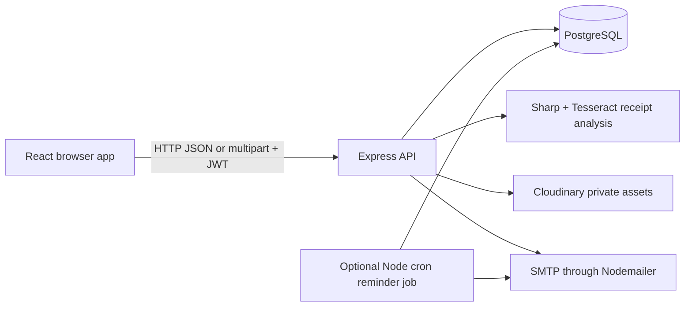
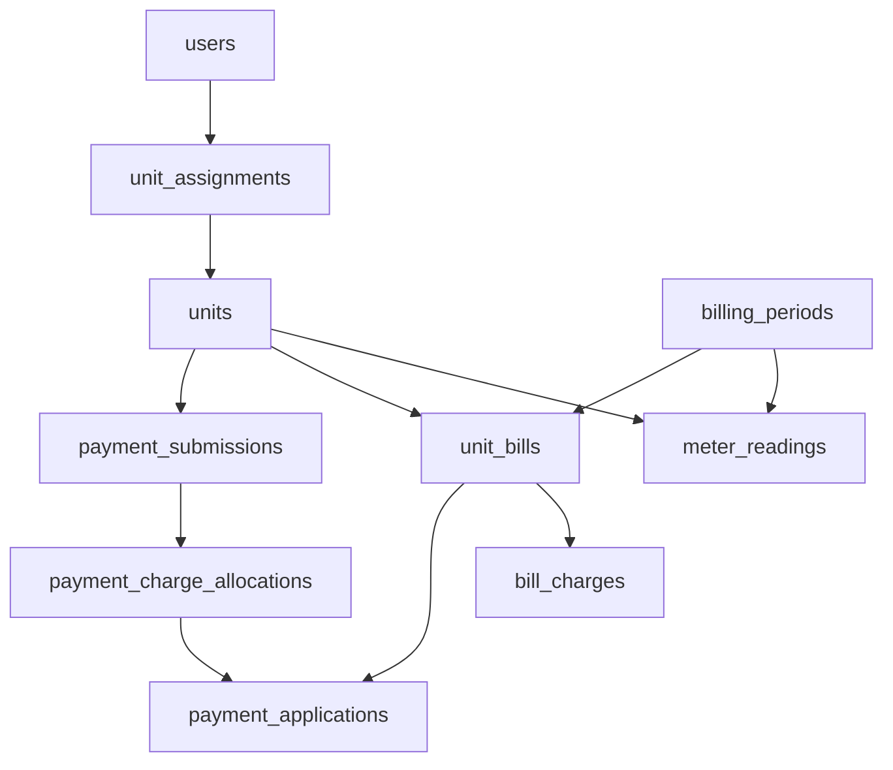
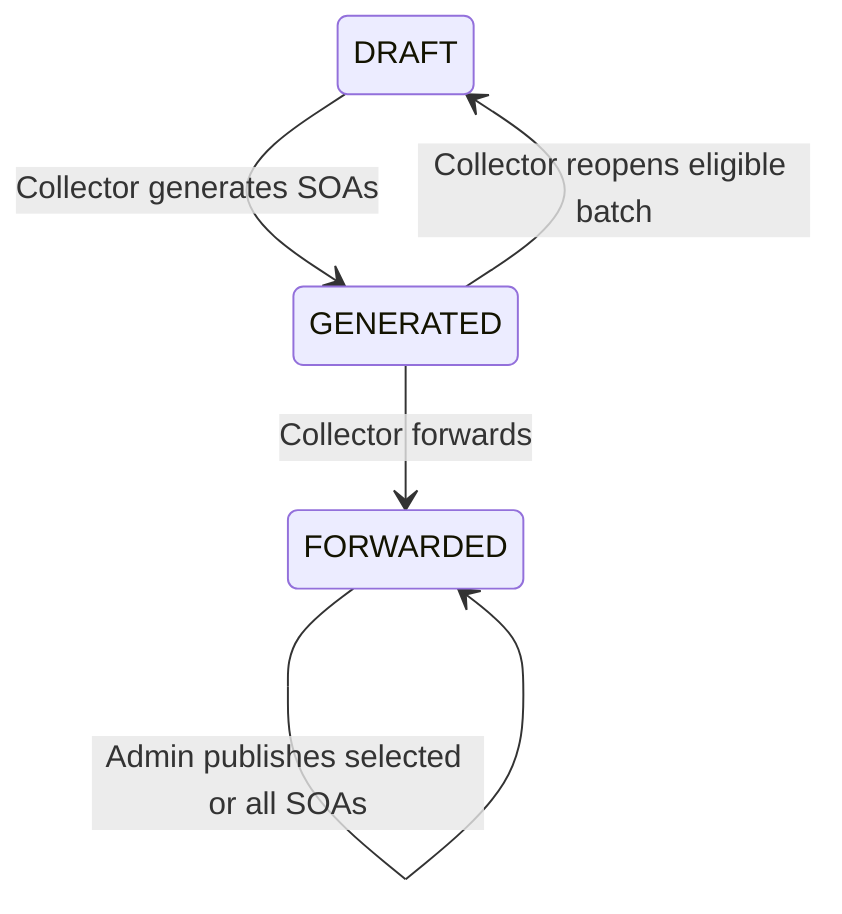

# RSG Condo Codebase Overview

Source checked: October 13, 2026. Start here, then read the [frontend guide](FRONTEND_CODE_GUIDE.md) and [backend guide](BACKEND_CODE_GUIDE.md). The [docs index](README.md) contains a study plan.

## 1. What you are learning

RSG Condo manages condominium units, resident assignments, monthly water and association charges, Statements of Account (SOAs), payment proofs, accounting allocations, and water-use analytics.

| Role in code | Responsibilities in the current implementation |
| --- | --- |
| `ADMIN` | Manage accounts, units and assignments; configure the SOA template/assets; publish or unpublish SOAs; record and verify payments; review reports, billing errors and audit history. |
| `COLLECTOR` | Create live billing periods, import readings, generate and forward batches; import analytics history; review approved payments; enter invoice references; correct eligible SOAs and resolve billing-error reports. The UI also calls this role Billing Associate. |
| `RESIDENT` | View published SOAs for assigned units, submit permitted payment proofs, report SOA errors, view payment history and water insights. Owner/tenant assignment changes payment permissions within this role. |

Public registration creates a Resident account only. The account can become eligible for login through email verification or Admin approval; both are not required together. Residents still need a unit assignment to see that unit's records.

## 2. Architecture

The browser handles forms, navigation, filtering and presentation. The backend decides access, validates readings, calculates balances and forecasts, and coordinates database writes. PostgreSQL stores the records and enforces constraints. OCR suggests receipt facts; Admin verifies the accounting facts.

The forecasting implementation runs in JavaScript under `backend/services/`; the `ml/` folder contains historical workbook inputs, not a separate running prediction API.

| Folder | What to look for |
| --- | --- |
| [frontend/src](../frontend/src/) | React entry point, route table, pages, components, authentication and API helper. |
| [backend/routes](../backend/routes/) | HTTP handlers, role checks, SQL and workflow orchestration. There is no `backend/src/` directory. |
| [backend/services](../backend/services/) | Reusable calculations, forecasting, OCR, mail, storage, notifications and audits. |
| [backend/database](../backend/database/) | Base schema and numbered migrations: the executable database definition. |
| [backend/scripts](../backend/scripts/) | Setup, imports, migration checks, regression and analytics diagnostics. |
| [backend/test](../backend/test/) and [frontend/test](../frontend/test/) | Examples of expected behavior using Node's built-in test runner. |
| [database](../database/) | Additional SQL artifacts, including the shareable units-only seed. |
| [system](../system/) | Operational user manual and its generator. |

## 3. Vocabulary and data relationships

| Term/table | Meaning |
| --- | --- |
| `users` | Login identity, role, active/approval/verification state, password hash and session version. |
| `units` | Physical unit number, floor, occupancy and billable area in square meters. |
| `unit_assignments` | Connect a Resident to a unit as `OWNER` or `TENANT`, with dates and primary-payer flag. |
| `billing_periods` | Dates, rates and workflow state. `LIVE_BILLING` creates SOAs; `HISTORICAL_ANALYTICS` supplies analytics readings only. |
| `meter_readings` | Previous/current cumulative readings, calculated consumption and validation status. |
| `unit_bills` | One SOA for a unit and period, with snapshots, publication state, penalty and revision metadata. |
| `bill_charges` | Charge lines such as `WATER` and `ASSOCIATION_DUES`, using quantity times rate. |
| `payment_submissions` | Proof or manual payment record, purpose, intended SOA, OCR facts and review state. |
| `payment_charge_allocations` | Approved cash designated to a charge category; invoice number belongs here. |
| `payment_applications` | Amount of a category allocation actually applied to a bill's principal or late penalty. |
| `billing_forecasts` | Forecast per unit/source period, model and eligibility metadata. |
| `prescriptive_recommendations` | Explainable advice and its current `OPEN`, `VIEWED` or `SUPERSEDED` state. |
| `billing_error_reports` | Resident report and staff resolution about an SOA. |
| `soa_templates`, `soa_email_deliveries`, `soa_reminder_deliveries` | Template configuration, publication mail attempts and deduplicated due-date reminders. |
| `user_notifications`, `audit_logs` | User-facing alerts and administrative change history. |

This is a conceptual relationship map, not a complete ERD. Read migrations for foreign keys and deletion behavior. Older migrations mention `billing_events`, `payment_submission_targets` and `prescriptive_recommendation_actions`; later migrations remove them. Current payment targets live on `payment_submissions.target_unit_bill_id`, and audits use `audit_logs`.

## 4. Follow one request

Example: Resident opens an SOA.

1. [App.jsx](../frontend/src/App.jsx) matches `/resident/bills/:id` and renders `ProtectedRoute` around `ResidentBillPage`.
2. The page obtains `token` from `useAuth` and calls `apiRequest('/api/bills/<id>', { token })`.
3. [api.js](../frontend/src/services/api.js) adds `Authorization: Bearer <token>` and calls `VITE_API_URL`.
4. [server.js](../backend/server.js) mounts [billRoutes.js](../backend/routes/billRoutes.js) at `/api/bills`.
5. `requireAuth` verifies the JWT and checks the current database user/session version. The bill route checks resident visibility, including publication and assignment.
6. SQL and payment services build the bill's charges, balances and resident-specific payable fields.
7. The response contains `bill`; the page updates React state and renders `SoaViewer` and payment controls.

A frontend route such as `/resident/bills/12` is a browser page. `/api/bills/12` is the backend endpoint returning data. Sharing a similar name does not make them the same route.

## 5. Monthly billing lifecycle

Publication is stored on each bill (`published_at`). The current publish/unpublish handlers change bill visibility without changing batch status, so a fully published live batch can remain `FORWARDED`. `CLOSED` is an accepted state used by historical imports and supported by staff/resident reads; do not infer it from publication alone.

1. Admin creates units/assignments and configures the template.
2. Collector creates a draft period with coverage, due date, rates and penalty percentage.
3. Workbook preview parses `UNIT`, `PREVIOUS`, `PRESENT`. Saving normalized readings is a separate operation.
4. Generation snapshots the statement data and creates water/association charge lines. Missing or flagged readings produce zero water charge plus a warning; unit billable areas are required.
5. Collector resolves flagged readings before forwarding. Forwarding refreshes forecasts and recommendations and notifies Admin.
6. Admin publishes selected or all SOAs, optionally sending email. Residents see only published bills they can access.

Generation makes bills; forwarding submits them for review; publication exposes them to Residents. These are separate actions.

### Calculation example

For a valid reading from 100 to 108, consumption is 8 cubic meters. At PHP 50 per cubic meter, water is PHP 400. A 30-square-meter unit at PHP 20 per square meter owes PHP 600 in association principal. The base SOA is PHP 1,000. A configured 5% late penalty on fully unpaid association principal adds PHP 30 after the due date; water does not receive that penalty. Approved applications reduce the balance.

## 6. Payments: four different concepts

Submission is a claim/proof. Approval verifies the cash facts. Allocation designates that cash to water or association dues. Application reduces a particular SOA component. Unapplied allocated cash remains category credit.

For association PHP 1,608.84 and water PHP 58.90, an approved `WATER` payment of PHP 58.90 settles water only. The SOA remains partially paid because association dues remain. A tenant may nevertheless see their water payable balance as zero.

An `OWNER` can choose `WATER`, `ASSOCIATION_DUES` or `COMBINED`. A tenant without an owner assignment can choose `WATER` only. Combined payment covers association principal/penalty before water; excess remains association advance. Category-only excess stays in its category.

Approval applies to the selected SOA. It does not sweep unrelated old bills or existing credit. Future bill generation can consume eligible category advances. Invoice numbers are per approved payment/category, allowing multiple partial payments on one SOA. The [backend guide](BACKEND_CODE_GUIDE.md#5-payments-and-the-accounting-ledger) explains these rules in detail.

## 7. Water analytics

Read [predictiveAnalytics.js](../backend/services/predictiveAnalytics.js) for calculations and [analyticsPeriods.js](../backend/services/analyticsPeriods.js) for training-data visibility.

- Eligibility requires at least five consecutive valid months; the training window uses up to 12.
- A flagged newest reading or gap interrupts the valid segment. A real zero reading remains valid and visible on charts.
- The active policy is `regression_first`: use Linear Regression normally. A qualifying spike or unexpected zero in the latest three readings temporarily activates Stable Recent Months; each event needs five preceding valid months. The stable formula averages last month, the recent three-month average and the recent five-month median. Return to regression when the event expires, without replacing readings. Staff see the model-selection reason; unavailable results display as "No forecast".
- Forecasts estimate next-month consumption and water charge. They do not create actual bill charges.
- Accuracy uses valid forecast/actual pairs and includes MAE, RMSE and WAPE. `accuracy` is derived from WAPE, not a confidence probability.
- Prescriptive rules turn history, forecasts, occupancy and balances into review tasks, high/rising-use alerts, monitoring insights and payment reminders.

Generated-batch resident insights can be visible before SOA publication. This is distinct from bill visibility and from the separate mail reminder scheduler.

## 8. How to study a feature

Pick one action and locate its click/submit handler. Find the `apiRequest` call and JSON/FormData fields. Match the endpoint to `server.js` and its router. Read middleware, validation, transaction, service calls and SQL in that order. Then read the relevant test to see an example that must keep working.

Use browser Network tools to compare the request with the handler. A 401 usually means session/token failure; 403 means permission/account state; 409 often means a workflow or uniqueness conflict; 400 usually means input validation. The exact response message is more useful than status alone.

For setup and runnable checks, follow the detailed guides. Do not run migration, import, approval or mail commands against a shared database just to understand the code.
