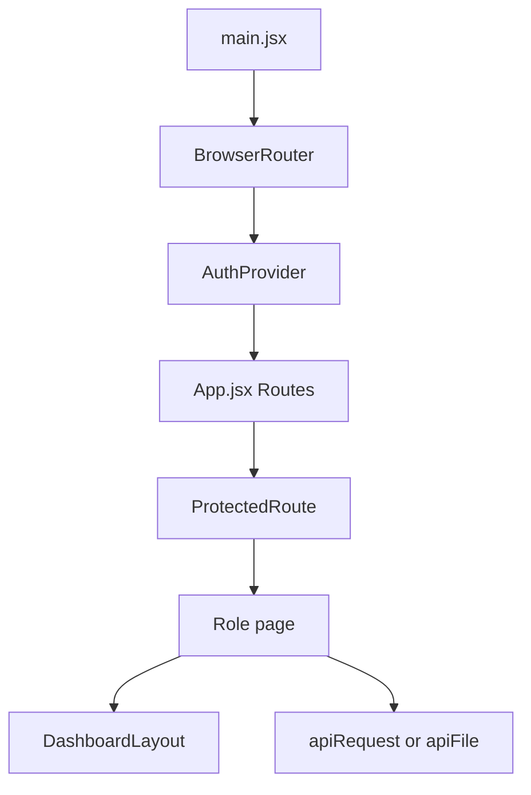

# Frontend Code Guide

Source checked: October 27, 2026. This guide explains current application-owned files under `frontend/src`, how they work together, and where to begin when changing a feature. Read the [overview](CODEBASE_OVERVIEW.md) for orientation and keep the [backend guide](BACKEND_CODE_GUIDE.md) open while tracing API calls. Current source and these updated guides take precedence over older workflow descriptions.

## Contents

1. [Learning order and React basics](#1-learning-order-and-react-basics)
2. [Startup, routes and session](#2-startup-routes-and-session)
3. [Requests and page state](#3-requests-and-page-state)
4. [Page and route reference](#4-page-and-route-reference)
5. [Shared components](#5-shared-components)
6. [Utility and styling reference](#6-utility-and-styling-reference)
7. [Worked feature traces](#7-worked-feature-traces)
8. [Development and debugging](#8-development-and-debugging)

## 1. Learning order and React basics

Read `main.jsx`, `App.jsx`, `AuthContext.jsx`, `ProtectedRoute.jsx`, and `api.js` in that order. Then read `ResidentBillsPage.jsx` as a small data-loading page before opening the larger billing, payment and analytics screens.

| React concept | Meaning in this project |
| --- | --- |
| Component | A function returning JSX, such as `ResidentBillsPage` or `ChargePaymentSummary`. Capitalized JSX names refer to components. |
| Props | Inputs passed by a parent: `SoaViewer` receives `bill`; shared dashboards receive a role. |
| `useState` | Values whose changes rerender a screen: loaded records, selected unit, filter, form, busy/error state. |
| `useEffect` | Synchronizes with API requests, browser events, timers or object URLs after rendering. Dependencies determine when it reruns; cleanup stops obsolete work. |
| Context | Shared identity/session state supplied by `AuthProvider`, accessed through `useAuth`. Most feature data is page-local. |
| Derived state | Values computed from existing records, such as filtered rows or selected charge balance. These are display calculations, not authoritative ledger updates. |
| Event handler | Function triggered by a click/change/submit; it validates local input, calls the API, and updates state. |

There is no Redux or React Query layer here. Pages use React state/effects and the shared fetch helper. This means each page's loading, refresh and error handling matters.

Backend helpers are now grouped into 12 feature services. Browser pages remain under `pages`, shared UI under `components`, presentation helpers under `utils`, and HTTP access under `services/api.js`. Use the [backend service map](../backend/services/README.md) when tracing a browser action; do not look for the removed small backend helper files.

## 2. Startup, routes and session



| File | What to learn |
| --- | --- |
| [main.jsx](../frontend/src/main.jsx) | Mounts into `#root` in `StrictMode`, then `BrowserRouter`, `AuthProvider`, and `App`; imports global CSS. |
| [App.jsx](../frontend/src/App.jsx) | The actual route table. `HomeRedirect` waits for session initialization and sends users to login or their role dashboard; unknown URLs redirect to `/`. |
| [routes.js](../frontend/src/constants/routes.js) | `dashboardPathFor(role)` centralizes role landing paths. |
| [auth-context.js](../frontend/src/context/auth-context.js) | Defines the React context object separately from its provider. |
| [AuthContext.jsx](../frontend/src/context/AuthContext.jsx) | Owns user/token/initializing, `login`, `replaceToken`, `updateUser` and `logout`. Restores `condo_token` and `condo_user` from localStorage, validates the token through `/api/auth/me`, and clears a failed session. |
| [useAuth.js](../frontend/src/hooks/useAuth.js) | Reads the context so pages do not import the context object directly. |
| [ProtectedRoute.jsx](../frontend/src/components/ProtectedRoute.jsx) | Waits for initialization; redirects signed-out users to `/login`; redirects a wrong-role user to their own dashboard. Accepts `allowedRole` or `allowedRoles`. |

### What happens at login

`Login.jsx` submits credentials to `AuthProvider.login`. The provider posts to `/api/auth/login`, stores the returned token/user and updates state. The page redirects with `dashboardPathFor`. Login requires an active, Admin-approved account; email verification alone does not approve registration. A token change triggers `/api/auth/me` validation. `logout` clears browser storage and context. Password changes call `replaceToken`; staff profile/email changes use `updateUser` and replace the token when the API requires it.

The cached user is for immediate UI state; the backend reloads the current user's role/active state and checks `auth_version` on protected requests. Frontend guards improve navigation but cannot enforce database access.

`StrictMode` can rerun effect setup/cleanup during development. Effects that subscribe, poll or fetch need cleanup. `VerifyEmail.jsx` caches verification requests by token so repeating an effect does not consume the same verification token twice.

## 3. Requests and page state

[services/api.js](../frontend/src/services/api.js) is the HTTP boundary. `API_URL` uses `VITE_API_URL`, defaults to `http://localhost:5000`, and removes a trailing slash.

`apiRequest(path, { token, body, ...options })` adds the bearer header, JSON-serializes non-FormData bodies, parses response JSON, and throws an Error for an unsuccessful response. The error retains `status` and backend JSON in `data`. Network failures get a reachability message. It does not automatically log users out on every failed page request; the page or authentication provider handles its own failures.

`apiFile(path, { token, signal })` fetches an authenticated blob for receipt images, template assets or workbook exports. It throws the server message on failure. Pages create object URLs to display/download blobs and should revoke them when done. Resident Request SOA uses JSON requests/status polling; its protected PDF is an email attachment, not an `apiFile` download.

Illustrative calls using the existing helper:

```js
const { bills } = await apiRequest('/api/bills', { token })

const body = new FormData()
body.append('receipt', file)
body.append('paymentPurpose', selectedPurpose)
await apiRequest(`/api/payments/bills/${billId}/preview`, {
  method: 'POST', token, body,
})
```

Do not manually set multipart `Content-Type`: the browser supplies the boundary. Live workbook preview uses the upload field `file`; receipt upload uses `receipt`; template uploads use `asset`.

### Read a page in this order

1. Imports identify its layout, API helper and shared calculations.
2. State declarations show the records, filters, forms and dialogs it owns.
3. Effects/load functions show initial fetch and refresh behavior. Independent calls may use `Promise.all`.
4. Submit/action handlers show method, payload, validation and post-save refresh.
5. Derived values show how records become totals, visible rows or options.
6. JSX shows loading/error/empty/success states and when controls are disabled.

Several pages use an `active` flag in effect cleanup to avoid applying a stale request's result. Timer-based pages also clear timers. A failed fetch and a successful empty result are different states and should remain distinguishable.

## 4. Page and route reference

Paths below are browser routes from `App.jsx`; API paths in the third column go to Express. Filenames link directly to source.

### Public and shared account pages

| File / browser route | Purpose | Data/API |
| --- | --- | --- |
| [Login.jsx](../frontend/src/pages/Login.jsx), `/login` | Sign-in, remembered email and account activation handling. | `AuthProvider.login`; `/api/auth/login`. |
| [Register.jsx](../frontend/src/pages/Register.jsx), `/register` | Email OTP first, then first name/optional MI/last name and password. Successful account creation waits for separate Admin approval; no staff-role selection. | `POST /api/auth/register/send-otp`, `/register/verify-otp`, `/register`. |
| [VerifyEmail.jsx](../frontend/src/pages/VerifyEmail.jsx), `/verify-email` | Consume a query-string token, show result, resend verification. | `GET /api/auth/verify-email?token=...`; `POST /api/auth/resend-verification`. |
| [PendingApproval.jsx](../frontend/src/pages/PendingApproval.jsx), `/pending-approval` | Explain separate Admin approval and legacy verification resend where needed. | `POST /api/auth/resend-verification`. |
| [ForgotPassword.jsx](../frontend/src/pages/ForgotPassword.jsx), `/forgot-password` | Request a six-digit email code and save challenge timing before navigating to reset. | `POST /api/auth/forgot-password`. |
| [ResetPassword.jsx](../frontend/src/pages/ResetPassword.jsx), `/reset-password` | Verify the OTP, hold the reset grant in component state, set/confirm a new password and end the old session. | `POST /api/auth/verify-password-reset-otp`, `/reset-password`; resend uses `/forgot-password`. |
| [ProfilePage.jsx](../frontend/src/pages/shared/ProfilePage.jsx), `/profile` | Show identity; Resident self-service password change. | Context; `POST /api/auth/change-password`, then `replaceToken`. |
| [SettingsPage.jsx](../frontend/src/pages/shared/SettingsPage.jsx), `/settings` | Sidebar preference for all roles; staff additionally edit profile, verify a new email and change password through `StaffAccountSettings`. | Browser storage/events; staff `/api/account/...` and `/api/auth/change-password`. |
| [NotificationsPage.jsx](../frontend/src/pages/shared/NotificationsPage.jsx), `/notifications` | Full notification list and read actions. | `/api/notifications`; read/read-all endpoints. |

The final three pages allow all authenticated roles.

### Admin pages

| File / browser route | Responsibility | Main API family |
| --- | --- | --- |
| [AdminDashboard.jsx](../frontend/src/pages/admin/AdminDashboard.jsx), `/admin` | Thin wrapper around `OperationalDashboard` for Admin. | `/api/dashboard/overview`, `/api/analytics/overview`. |
| [AdminUsersPage.jsx](../frontend/src/pages/admin/AdminUsersPage.jsx), `/admin/users` | Account creation/editing, approval, activation/deactivation and guarded deletion. `AccountActionModal` loads current assignment/balance eligibility before destructive account actions. | `/api/users`; approval uses `PATCH` with `approvalStatus`. |
| [AdminUnitsViewPage.jsx](../frontend/src/pages/admin/AdminUnitsViewPage.jsx), `/admin/units` | Read-only occupancy/assignment overview; also reused by Collector route. | `/api/units`, `/api/unit-assignments`. |
| [AdminUnitsPage.jsx](../frontend/src/pages/admin/AdminUnitsPage.jsx), `/admin/units/manage` | Unit forms and Resident assignment/ending, with billing/payment context. | Units, assignments, users, bills and payments. |
| [AdminSoaPage.jsx](../frontend/src/pages/admin/AdminSoaPage.jsx), `/admin/soa` | Forwarded batch list, refreshed periodically. | `/api/billing-periods`. |
| [AdminSoaBatchPage.jsx](../frontend/src/pages/admin/AdminSoaBatchPage.jsx), `/admin/soa/batches/:periodId` | Select/publish bills with or without email; delivery status and retry/resend; single, selected or all unpublish actions. Selected/all unpublish use the password confirmation modal. | `/api/bills?billingPeriodId=...`; `/api/billing-periods/:id/...`. |
| [AdminSoaBillPage.jsx](../frontend/src/pages/admin/AdminSoaBillPage.jsx), `/admin/soa/bills/:id` | View, publish, correct, edit payment note and category invoice references. | `/api/bills/:id`; publication/delivery routes; shared invoice editor. |
| [AdminPaymentsPage.jsx](../frontend/src/pages/admin/AdminPaymentsPage.jsx), `/admin/payments` | Payment queue and manual/advance entry with allocation preview. | Payments, units, bills and credits; `POST /api/payments/manual`. |
| [AdminPaymentPage.jsx](../frontend/src/pages/admin/AdminPaymentPage.jsx), `/admin/payments/:id` | Private receipt/OCR review, verified facts, allocation preview, approval/rejection, rejected-record deletion and invoice entry. | `/api/payments/:id`, receipt/review/invoice-reference endpoints. |
| [AdminAuditLogsPage.jsx](../frontend/src/pages/admin/AdminAuditLogsPage.jsx), `/admin/audit-logs` | Compact user-change feed with saved actor/record identity, changes, filters and stable pagination. SOA publication names the resident/unit, or gives the bulk count and saved previews. | `/api/audit-logs`; current rows do not request expanded detail. |

`/admin/assignments` redirects to `/admin/units/manage`. [AdminAssignmentsPage.jsx](../frontend/src/pages/admin/AdminAssignmentsPage.jsx) remains in source but is not imported/routed by the current `App.jsx`.

### Collector pages

| File / browser route | Responsibility | Main API family |
| --- | --- | --- |
| [CollectorDashboard.jsx](../frontend/src/pages/collector/CollectorDashboard.jsx), `/collector` | Thin wrapper around shared staff dashboard. | Dashboard and analytics overview. |
| [CollectorBillingPage.jsx](../frontend/src/pages/collector/CollectorBillingPage.jsx), `/collector/billing` | Validated period/rates/dates, workbook preview, normalized reading save and generation with busy/progress feedback. | `/api/billing-periods`; `readings/preview`, `readings`, `generate`. |
| [CollectorBillsPage.jsx](../frontend/src/pages/collector/CollectorBillsPage.jsx), `/collector/bills` | Batch list/filter and reopen/forward/delete actions. | Periods and bills. |
| [CollectorBillBatchPage.jsx](../frontend/src/pages/collector/CollectorBillBatchPage.jsx), `/collector/bills/batches/:periodId` | Bill list inside one batch. | `/api/bills?billingPeriodId=...`. |
| [CollectorBillPage.jsx](../frontend/src/pages/collector/CollectorBillPage.jsx), `/collector/bills/:id` | View/correct SOA and edit allowed payment references. | `/api/bills/:id`; shared invoice editor. |
| [CollectorHistoryImportPage.jsx](../frontend/src/pages/collector/CollectorHistoryImportPage.jsx), `/collector/history-import` | Reading-only workbook preview/import, saved workbook download and month deletion. Requires unit and previous/current readings; extra spreadsheet rate/charge columns are ignored. | `/api/analytics/imports`; `/:periodMonth/workbook`. |
| [CollectorPaymentsPage.jsx](../frontend/src/pages/collector/CollectorPaymentsPage.jsx), `/collector/payments` | Approved-payment list/details and category invoice entry. | `/api/payments?status=APPROVED`. |
| [CollectorSoaTemplatePage.jsx](../frontend/src/pages/collector/CollectorSoaTemplatePage.jsx), `/admin/soa-template` | Template text/color/layout and logo/QR assets. Despite its name, current routing and writes are Admin-only. | `/api/soa-template`; `/assets/:type`. |

`/collector/units` renders `AdminUnitsViewPage`. [CollectorUnitsPage.jsx](../frontend/src/pages/collector/CollectorUnitsPage.jsx) and [ReadOnlyRecords.jsx](../frontend/src/components/ReadOnlyRecords.jsx) are retained alternatives, not the current route implementation. Do not infer reachability or permission from a filename.

### Resident pages

| File / browser route | Responsibility | Main API family |
| --- | --- | --- |
| [ResidentDashboard.jsx](../frontend/src/pages/resident/ResidentDashboard.jsx), `/resident` | Select assigned unit, show current payable bill, consumption/history/forecast and viewable insights. | Bills, `/api/analytics/resident`, resident recommendations/view action. |
| [ResidentBillsPage.jsx](../frontend/src/pages/resident/ResidentBillsPage.jsx), `/resident/bills` | Published SOA list with assignment-aware payable amounts. | `/api/bills`. |
| [ResidentBillPage.jsx](../frontend/src/pages/resident/ResidentBillPage.jsx), `/resident/bills/:id` | Protected viewer, Request SOA email button, assignment-aware payment purpose, receipt preview/final submission, QR and billing-error form. | Bill detail; `/api/bills/:id/protected-exports`; payments preview/submit; QR; billing-error endpoint. |
| [ResidentPaymentsPage.jsx](../frontend/src/pages/resident/ResidentPaymentsPage.jsx), `/resident/payments` | Filtered submission history with verified/category/invoice detail. | `/api/payments`. |

### Shared staff pages

| File | Browser routes and behavior |
| --- | --- |
| [OperationalDashboard.jsx](../frontend/src/pages/shared/OperationalDashboard.jsx) | Used by the two staff dashboard wrappers; fetches operational and analytics summaries. |
| [AnalyticsPage.jsx](../frontend/src/pages/shared/AnalyticsPage.jsx) | `/admin/analytics`, `/collector/analytics`: forecasts, history, diagnostics and recommendations; uses analytics overview/refresh and staff recommendation APIs. |
| [FinancialReportsPage.jsx](../frontend/src/pages/shared/FinancialReportsPage.jsx) | `/admin/reports`, `/collector/reports`: date/month filters, overview/charge/receivable/occupancy tabs, workbook export and print layout; `/api/reports/financial` and `/financial/export`. |
| [BillingErrorsPage.jsx](../frontend/src/pages/shared/BillingErrorsPage.jsx) | `/admin/billing-errors`, `/collector/billing-errors`: open/resolved/all report list. Only Collector receives resolution controls and calls `PATCH /api/billing-errors/:id/resolve`. |

## 5. Shared components

| File | Role in the UI |
| --- | --- |
| [DashboardLayout.jsx](../frontend/src/components/DashboardLayout.jsx) | Role-aware navigation, responsive sidebar, account links, notification bell and logout. Named `Panel`/`EmptyRow` provide common content/empty presentation. |
| [BrandMark.jsx](../frontend/src/components/BrandMark.jsx) | Shared brand rendering for account pages and layout. |
| [NotificationCenter.jsx](../frontend/src/components/NotificationCenter.jsx) | Polling bell/popover, unread count, read actions, toast and optional browser alerts. Clears interval/listeners on cleanup. |
| [NoticeToast.jsx](../frontend/src/components/NoticeToast.jsx) | Reusable transient notice presentation. |
| [ReadOnlyRecords.jsx](../frontend/src/components/ReadOnlyRecords.jsx) | Retained units/assignments read-only component; not the implementation selected for current unit routes. |
| [SoaDocument.jsx](../frontend/src/components/SoaDocument.jsx) | Printable SOA formatting, snapshots, charge/invoice sections and authenticated template assets. Displays backend accounting values; also derives presentation values from charge lines. |
| [SoaViewer.jsx](../frontend/src/components/SoaViewer.jsx) | Responsive fit/zoom wrapper around the fixed-format SOA. Resize measurement and viewer scaling do not alter accounting data. |
| [ProtectedSoaDownload.jsx](../frontend/src/components/ProtectedSoaDownload.jsx) | Despite the retained filename, this emails a protected SOA. It checks server state, posts an idempotent request, polls pending work and changes to a disabled **SOA already sent in email** button for 30 minutes. No success panel or browser PDF download is shown. |
| [UnpublishBatchModal.jsx](../frontend/src/components/UnpublishBatchModal.jsx) | Current-password confirmation for selected/all SOA unpublishing, including selected unit context and pending controls. |
| [ReceiptImageViewer.jsx](../frontend/src/components/ReceiptImageViewer.jsx) | Receipt image loading/error presentation and image-viewing controls. |
| [AccountActionModal.jsx](../frontend/src/components/AccountActionModal.jsx) | Rechecks account assignment/balance eligibility and explains blocked account actions. |
| [PasswordInput.jsx](../frontend/src/components/PasswordInput.jsx), [OtpInput.jsx](../frontend/src/components/OtpInput.jsx) | Password reveal/requirements/confirmation and six-digit code entry shared by account flows. |
| [StaffAccountSettings.jsx](../frontend/src/components/StaffAccountSettings.jsx) | Staff profile, current-password checks, email-change OTP verification, password changes and context refresh. |
| [UnitWaterAnalytics.jsx](../frontend/src/components/UnitWaterAnalytics.jsx) | Unit selection/history/forecast charts with explicit unavailable data and range controls. |
| [AdminWaterGuidance.jsx](../frontend/src/components/AdminWaterGuidance.jsx) | Admin consumption/billing guidance from the API; the browser does not calculate accounting changes. |
| [CombinedBillingReport.jsx](../frontend/src/components/CombinedBillingReport.jsx) | Overall billing totals and per-unit rows, with screen/print variants and grouped currency. |
| [ChargePaymentSummary.jsx](../frontend/src/components/ChargePaymentSummary.jsx) | Water/association payment and balance summaries. |
| [PaymentAllocationPreview.jsx](../frontend/src/components/PaymentAllocationPreview.jsx) | Debounced Admin read-only preview through `POST /api/payments/allocation-preview`. Signals which input request has a completed preview. Save revalidates on the server. |
| [PaymentAllocationDetails.jsx](../frontend/src/components/PaymentAllocationDetails.jsx) | Displays category allocation/application details returned by the API. |
| [PaymentInvoiceEditor.jsx](../frontend/src/components/PaymentInvoiceEditor.jsx) | Per-payment/category invoice editor; can receive a payment or derive payment IDs from a bill. Loads approved payment detail and patches `invoices` to `/api/payments/:id/invoice-references`. |
| [InvoiceSectionButton.jsx](../frontend/src/components/InvoiceSectionButton.jsx) | Navigation/action control for the SOA invoice section. |
| [AdminPaymentQueue.jsx](../frontend/src/components/AdminPaymentQueue.jsx) | Queue filters, sorting and pagination using `paymentQueue.js`; links to payment detail. |
| [ResidentPaymentCard.jsx](../frontend/src/components/ResidentPaymentCard.jsx) | Resident history item with status, purpose, verified facts and invoices. |

`ProtectedRoute` is documented in section 2. `SoaViewer` starts concealed behind the View SOA control and conceals again on tracked vertical scroll changes. This is a presentation/privacy aid; API authorization and PDF encryption are the access controls. Staff print actions are separate from resident email-only PDF delivery.

## 6. Utility and styling reference

| File | Important behavior |
| --- | --- |
| [chargePayments.js](../frontend/src/utils/chargePayments.js) | Purpose labels/currency, `isWaterOnly`, `payableBalance`, `payablePaid`, category detail access. Prefer these helpers over reading full-SOA balance for a tenant card. |
| [paymentHistory.js](../frontend/src/utils/paymentHistory.js) | Verified versus unverified amount summary, dates/method labels and category invoice references. |
| [paymentQueue.js](../frontend/src/utils/paymentQueue.js) | Default queue filters, amount/date normalization, filtering/sorting and page slicing. |
| [forecastChart.js](../frontend/src/utils/forecastChart.js) | Numeric normalization and connection between actual and projected chart series. Preserve true zero values. |
| [forecastModelLabel.js](../frontend/src/utils/forecastModelLabel.js) | Human-readable labels for backend model identifiers, including stable ensemble. |
| [auditLogPresentation.js](../frontend/src/utils/auditLogPresentation.js) | Actor/action/target labels, Manila timestamps, safe scalar changes and detailed single/bulk SOA publication summaries. |
| [billingPeriodPolicy.js](../frontend/src/utils/billingPeriodPolicy.js) | Browser date/rate validation and calendar bounds; backend `billing.js` remains authoritative. |
| [passwordPolicy.js](../frontend/src/utils/passwordPolicy.js) | Browser password checklist/confirmation; source-parity checked against the password-policy section of backend `passwords.js`. |
| [receiptFilePolicy.js](../frontend/src/utils/receiptFilePolicy.js) | Receipt extensions/size checks; source-parity checked against the receipt-policy section of backend `receipts.js`. Server middleware validates genuine image content. |
| [passwordRecovery.js](../frontend/src/utils/passwordRecovery.js), [registrationRecovery.js](../frontend/src/utils/registrationRecovery.js) | Challenge metadata/timing recovery for OTP flows. Expiry and grant validity are enforced by the backend. |
| [unitWaterAnalytics.js](../frontend/src/utils/unitWaterAnalytics.js) | Chart-ready monthly unit history/projections, preserving valid zeroes and unavailable values. |
| [formatText.js](../frontend/src/utils/formatText.js) | Converts code labels into readable text with a fallback. |
| [index.css](../frontend/src/index.css) | Tailwind import, application variables/layout and print/SOA styling. Print styles remove viewer scaling and hide interactive controls. |

## 7. Worked feature traces

### Resident proof to approved payment

1. `ResidentBillPage` loads the bill and uses `allowedPaymentPurposes` from the backend. Tenants are water-only; owners can choose all supported purposes.
2. Selecting a receipt creates a local image preview. OCR preview posts `receipt` and `paymentPurpose` as FormData; successful preview is not an approved or saved payment.
3. Final submission posts to `/api/payments/bills/:id` and creates a pending record. The page refreshes bill context.
4. Admin opens `AdminPaymentPage`, loads JSON and the authenticated receipt blob, checks OCR, and enters verified amount/date/method/reference.
5. `PaymentAllocationPreview` asks the backend how that input would be designated. Admin approval posts to `/api/payments/:id/review`; the backend checks again under locks.
6. The page reloads payment detail. `PaymentInvoiceEditor` can then save separate or shared category invoices.

For a full SOA balance of PHP 1,667.74 containing water PHP 58.90, paying water PHP 58.90 can make `payableBalance` zero for a tenant while `remainingBalance` still contains association dues. Do not replace resident payable fields with the overall balance.

### Workbook to SOA

`CollectorBillingPage` creates/selects the period, sends workbook preview, saves reviewed reading rows with `PUT /api/billing-periods/:id/readings`, then requests generation. `CollectorBillsPage` forwards the batch. `AdminSoaBatchPage` publishes selected/all bills with the chosen email option. The backend owns quantities, rates, snapshot creation, access and workflow state.

Historical reading uploads use `CollectorHistoryImportPage` and a separate API. Required headers are `UNIT`, `PREVIOUS`, and `CURRENT` (`PRESENT` is also accepted). Consumption is computed; spreadsheet rate/charge columns are ignored. The server selects a saved financial rate and retains the uploaded workbook. See [HISTORY_IMPORT_FORMAT.md](HISTORY_IMPORT_FORMAT.md).

### Request SOA by email

1. `ResidentBillPage` renders `ProtectedSoaDownload` for the current bill. On mount, the component calls `GET /api/bills/:id/protected-exports` to restore any active preparation or cooldown; this does not send email.
2. Clicking Request SOA posts an empty body with a UUID `Idempotency-Key`. Network retries keep the same key, and in-progress responses are polled through `/api/soa-exports/:exportId` with abortable waits.
3. On `READY`, the UI removes all success details and shows only the disabled **SOA already sent in email** button. The tooltip briefly suggests checking Inbox/Spam and explains the wait. `nextRequestAt` controls the local unlock timer.
4. The backend enforces the 30-minute cooldown even with a new key or another tab. A `SOA_EMAIL_COOLDOWN` response restores the sent state. After expiry, the button can create a fresh request. Failure/verification messages appear only when an action needs attention.
5. The protected PDF is attached to the delivered email. Its opening password is the lowercase surname without spaces plus four random digits, and the email contains the exact password/instructions. The browser never receives the password or downloads this PDF through `apiFile`.

See [soa.js](../backend/services/soa.js) for access, rendering, encryption and cooldowns, and [email.js](../backend/services/email.js) for the shared email layout. SOA email dates use `January 1, 2026` style; balances use `PHP 2,228.24` style. The 30-minute wait governs another request, not the lifetime of an already emailed PDF.

### Publication to Activity Log

`AdminSoaBatchPage` and `AdminSoaBillPage` publish through `billingPeriodRoutes.js`. The backend records the actual affected SOAs through `audit.js`. `AdminAuditLogsPage` fetches compact rows; `auditLogPresentation.js` renders a single item as **Published SOA for Tanjiro Kamado · Unit 307 · [coverage]**, or displays a bulk count, saved resident/unit previews and email-queue count. Filtering/pagination use the list endpoint; clicking a row does not fetch a detail panel. Names come from saved audit context, preserving the historical actor and affected statement.

### SOA error and correction

`ResidentBillPage` posts the report. `BillingErrorsPage` lists it for staff. SOA detail correction can include `billingErrorReportId` and a reason. The backend requires an open report for billing-detail corrections when pending/approved payment activity exists. Correcting and resolving are separate operations: Collector closes the report with a resolution note.

### Forecast to chart

`AnalyticsPage` and `ResidentDashboard` consume backend histories/forecasts, format model names through `forecastModelLabel`, and connect series through `forecastChart`. The UI does not train the model. `READY`, `INSUFFICIENT_DATA`, and `FLAGGED_READING` represent different backend outcomes; a missing forecast is not a zero forecast.

### Find the matching backend service

| Frontend change | Backend route/service to trace |
| --- | --- |
| Registration or staff account details | `registrationRoutes.js`, `authRoutes.js`, `accountRoutes.js`; `accounts.js`, `passwords.js`, `email.js`. |
| SOA viewer/email request | `billRoutes.js`, `soaExportRoutes.js`; `billing.js`, `soa.js`, `email.js`. |
| Billing, reading imports or publication | `billingPeriodRoutes.js`, `analyticsImportRoutes.js`; `billing.js`, `spreadsheets.js`, `analytics.js`, `audit.js`. |
| Receipt upload or payment approval | `paymentRoutes.js`; `receipts.js`, `payments.js`, `billing.js`, `audit.js`. |
| Forecast charts or recommendations | `analyticsRoutes.js`, `prescriptiveRecommendationRoutes.js`; `analytics.js`. |
| Overall financial report | `financialReportRoutes.js`; `financialReports.js`, `payments.js`. |
| Activity feed | `auditLogRoutes.js`; `audit.js`. |

These are feature files under `backend/services`; their indexes and `// #region` comments identify the relevant subsection. See the [backend guide's service reference](BACKEND_CODE_GUIDE.md#8-service-reference).

## 8. Development and debugging

From `frontend/`:

```powershell
npm install
npm run dev
npm test
npm run lint
npm run build
npm run preview
```

Run `dev` for normal development; `preview` serves a built `dist/` after `build`. Configure `VITE_API_URL` in the frontend environment and restart Vite after changing it. VITE variables are public browser configuration, so backend credentials do not belong there. Follow [LOCAL_SETUP_GUIDE.md](../LOCAL_SETUP_GUIDE.md) for first-time installation.

`npm test` runs focused [utility tests](../frontend/test/), including charge/payment formatting, queue/history, forecast charts/model names, audit presentation and unit analytics. Browser scripts live separately under [test/browser](../frontend/test/browser/) and are not included in that glob.

| Browser script | What it checks |
| --- | --- |
| [protectedSoaDownloads.mjs](../frontend/test/browser/protectedSoaDownloads.mjs) | Compact sent button, 30-minute expiry with a controlled browser clock, refresh/new-tab recovery, network retry identity, verification, and no portal PDF download. |
| [emailTemplates.mjs](../frontend/test/browser/emailTemplates.mjs) | Nine synthetic email variants at desktop/mobile widths; generates local previews without SMTP. Imports grouped backend email/password services. |
| [auditLogs.mjs](../frontend/test/browser/auditLogs.mjs) | Saved identities, detailed single/bulk publications, filters, pagination and no detail expansion. |
| [registrationOtp.mjs](../frontend/test/browser/registrationOtp.mjs), [accountActions.mjs](../frontend/test/browser/accountActions.mjs) | Registration gating and guarded account actions. |
| [residentSoaPrivacy.mjs](../frontend/test/browser/residentSoaPrivacy.mjs) | Conceal/reveal, scrolling, fit/zoom and responsive SOA viewer behavior. |
| [selectedUnpublish.mjs](../frontend/test/browser/selectedUnpublish.mjs), [bulkUnpublish.mjs](../frontend/test/browser/bulkUnpublish.mjs) | Selection, confirmation/password handling and batch-state refresh. |
| [historyReadingsOnly.mjs](../frontend/test/browser/historyReadingsOnly.mjs), [paymentOfficialReceipts.mjs](../frontend/test/browser/paymentOfficialReceipts.mjs), [combinedFinancialReport.mjs](../frontend/test/browser/combinedFinancialReport.mjs) | Simplified reading imports, payment references and combined billing output. |

Most UI scripts require Vite running at `http://127.0.0.1:5173` and an installed Playwright module; set `PLAYWRIGHT_MODULE` if it is outside the project. They use mocked APIs/synthetic fixtures, not live resident mutations. Email previews can render without Vite. Read each script's setup and output directory before running. Lint/build, utility tests and mocked browser checks provide different evidence; they do not prove deployed inbox delivery.

| Symptom | Trace first |
| --- | --- |
| Unexpected redirect | `App.jsx`, `ProtectedRoute`, context initialization and role landing mapping. |
| Page cannot reach API | Network request URL, VITE configuration, backend health and terminal logs. |
| 403 or 409 on save | Backend error JSON and route rules; hiding a button cannot grant permission. |
| Tenant sees wrong amount | `payableBalance`/`payableApprovedAmount`, `allowedPaymentPurposes`, `chargePayments`. |
| Receipt/QR does not display | `apiFile` authentication, object URL lifetime, backend storage/asset response. |
| Wrong SOA print size | `SoaViewer`, `SoaDocument`, `index.css` print rules. |
| Request SOA stays disabled | `nextRequestAt`, server cooldown state and `SOA_EMAIL_COOLDOWN`; refresh/new tabs intentionally keep the 30-minute wait. |
| No PDF downloaded after Request SOA | Expected email-only behavior; inspect the delivered attachment and server request status. |
| Publication row lacks resident/unit | API `context.affectedTargets`/`affectedCount` and `auditLogPresentation`; identity can only be shown when saved history supplies it. |
| Duplicate/stale updates | Effect dependencies, StrictMode, active flags and timer/listener cleanup. |

### Practice without changing business data

1. Explain every step from `/resident/bills/:id` to the rendered charge summary.
2. Find where the UI chooses `WATER` and where the server enforces that permission.
3. Trace an invoice edit from the component payload to the database category allocation.
4. Compare the request for publication with and without email, then find the server's post-commit delivery behavior.
5. Explain why `CollectorSoaTemplatePage` is an Admin screen and why `CollectorUnitsPage` is not currently routed.

For a UI change, edit the page/component that owns the behavior, reuse existing helpers, and check loading, empty, error, success, small-screen and print states where applicable. For a new workflow or field, update the backend contract first and then its frontend consumers.
